<picture>
  <source media="(prefers-color-scheme: dark)" srcset="./assets/hero-dark.svg"/>
  <source media="(prefers-color-scheme: light)" srcset="./assets/hero-light.svg"/>
  
</picture>

  

<picture>
  <source media="(prefers-color-scheme: dark)" srcset="./assets/h-work-dark.svg"/>
  <source media="(prefers-color-scheme: light)" srcset="./assets/h-work-light.svg"/>
  
</picture>

<table>
  <tr>
    <td width="50%">
      <a href="https://github.com/ZG0704666/Aries-AI">
        <picture>
          <source media="(prefers-color-scheme: dark)" srcset="https://raw.githubusercontent.com/ZG0704666/ZG0704666/output/card-Aries-AI-dark.svg"/>
          <source media="(prefers-color-scheme: light)" srcset="https://raw.githubusercontent.com/ZG0704666/ZG0704666/output/card-Aries-AI-light.svg"/>
          
        </picture>
      </a>
    </td>
    <td width="50%">
      <a href="https://github.com/ZG0704666/Label-Once">
        <picture>
          <source media="(prefers-color-scheme: dark)" srcset="https://raw.githubusercontent.com/ZG0704666/ZG0704666/output/card-Label-Once-dark.svg"/>
          <source media="(prefers-color-scheme: light)" srcset="https://raw.githubusercontent.com/ZG0704666/ZG0704666/output/card-Label-Once-light.svg"/>
          
        </picture>
      </a>
    </td>
  </tr>
</table>

<a href="https://github.com/ZG0704666?tab=repositories">
  <picture>
    <source media="(prefers-color-scheme: dark)" srcset="./assets/archive-dark.svg"/>
    <source media="(prefers-color-scheme: light)" srcset="./assets/archive-light.svg"/>
    
  </picture>
</a>

  

<picture>
  <source media="(prefers-color-scheme: dark)" srcset="./assets/h-toolkit-dark.svg"/>
  <source media="(prefers-color-scheme: light)" srcset="./assets/h-toolkit-light.svg"/>
  
</picture>

<picture>
  <source media="(prefers-color-scheme: dark)" srcset="./assets/toolkit-dark.svg"/>
  <source media="(prefers-color-scheme: light)" srcset="./assets/toolkit-light.svg"/>
  
</picture>

  

<picture>
  <source media="(prefers-color-scheme: dark)" srcset="./assets/h-numbers-dark.svg"/>
  <source media="(prefers-color-scheme: light)" srcset="./assets/h-numbers-light.svg"/>
  
</picture>

<picture>
  <source media="(prefers-color-scheme: dark)" srcset="https://raw.githubusercontent.com/ZG0704666/ZG0704666/output/stats-dark.svg"/>
  <source media="(prefers-color-scheme: light)" srcset="https://raw.githubusercontent.com/ZG0704666/ZG0704666/output/stats-light.svg"/>
  
</picture>

  

<picture>
  <source media="(prefers-color-scheme: dark)" srcset="./assets/footer-dark.svg"/>
  <source media="(prefers-color-scheme: light)" srcset="./assets/footer-light.svg"/>
  
</picture>

